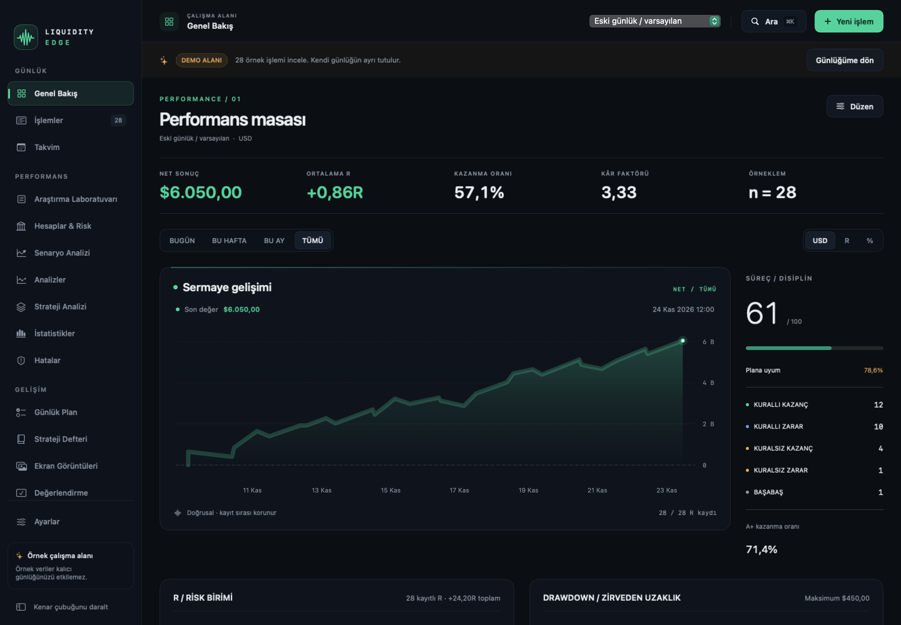

# LIQUIDITY EDGE — Native macOS İşlem Günlüğü (v6.0.0)

macOS 14 ve üzeri için tamamen yerel **Swift, SwiftUI, SwiftData, Swift Charts ve AppKit** ile geliştirilmiş profesyonel, çevrimdışı (offline) işlem günlüğü ve kantitatif analiz çalışma istasyonu.

## İndir (macOS — Universal Apple Silicon & Intel)

| Kurulum Paketi | İndirme Bağlantısı | Kurulum Şekli |
| --- | --- | --- |
| **macOS DMG (Önerilen)** | [Liquidity-Edge-macOS-Universal.dmg İndir](https://github.com/EdipMangtay/Trading_journals/releases/download/v6.0.0/Liquidity-Edge-macOS-Universal.dmg) | Açın ve **Liquidity Edge.app** uygulamasını **Applications (Uygulamalar)** klasörüne sürükleyin |
| **macOS PKG Yükleyici** | [Liquidity-Edge-macOS-Universal.pkg İndir](https://github.com/EdipMangtay/Trading_journals/releases/download/v6.0.0/Liquidity-Edge-macOS-Universal.pkg) | Çift tıklayın ve standart Apple Kurulum Sihirbazı ile `/Applications` içine kurun |

Tüm sürümler ve SHA-256 doğrulama özetleri için [Releases](https://github.com/EdipMangtay/Trading_journals/releases/latest) sayfasına bakabilirsiniz. **Kurulum için kaynak kodu ZIP'ini değil, yukarıdaki DMG veya PKG dosyasını indirin.**

### İlk Açılış Notu (macOS Gatekeeper)
Uygulama açık kaynak olarak derlenmiş olup Apple Developer ID sertifikası olmadan imzalandığı için ilk açılışta macOS güvenlik onayı isteyebilir:
1. Uygulamayı **Uygulamalar (Applications)** klasörüne kopyalayın ve açmayı deneyin.
2. Uyarı çıkarsa **Sistem Ayarları → Gizlilik ve Güvenlik** ekranının alt kısmından **"Yine de Aç"** butonuna tıklayın (alternatif olarak Terminal'de `xattr -cr "/Applications/Liquidity Edge.app"` komutunu çalıştırabilirsiniz).
3. Detaylar için [INSTALLATION.md](INSTALLATION.md) ve [SIGNING.md](SIGNING.md) dosyalarına bakabilirsiniz.

Yeni kurulumlar tertemiz, boş bir günlükle açılır; hiçbir demo veri gerçek günlüğünüze karışmaz. Tüm verileriniz ve ekran görüntüleriniz yalnızca sizin Mac'inizde saklanır.



## Öne Çıkan Özellikler

- **%100 Native Swift & macOS Deneyimi:** SwiftUI, SwiftData, Swift Charts ve AppKit tabanlı yüksek performanslı masaüstü uygulaması; Apple Silicon (M1/M2/M3/M4) ve Intel Mac desteği.
- **Performans Masası (Flagship Dashboard):** İnteraktif kayan cam tooltip'li (crosshair HUD), çift katmanlı ışıltılı sermaye eğrisi, süreç/disiplin rayı ve özelleştirilebilir widget düzeni.
- **Çoklu Hesap & Prop Firm Risk Merkezi:** Personal, Evaluation ve Funded hesaplar; statik ve gün sonu (EOD) trailing drawdown, günlük kayıp limiti, tutarlılık yüzdesi ve kural ihlali takibi.
- **Strateji Araştırma Laboratuvarı:** QT, MMXM, PO3, SSMT, TSMO ve CRT modelleri için Setup × Seans, Setup × Enstrüman çapraz matrisleri, A/B kohort karşılaştırmaları ve kayıtlı filtre ön ayarları.
- **Kantitatif Analiz & Monte Carlo:** Deterministik bootstrap / shuffle Monte Carlo simülasyonları, yüzdelik dilim bantları (5./50./95.), su altı (drawdown) toparlanma süresi ve hareketli beklenti eğrileri.
- **İşlem Planı & Kontrol Listeleri:** Seans öncesi piyasa senaryoları, likidite hedefleri ve model bazlı (QT, MMXM, CRT) ön/son kontrol listesi şablonları.
- **Gelişmiş İşlem İnceleme & Gerçekleşme Defteri:** Kademeli giriş/çıkış (fills), kayma (slippage) maliyeti, kontrat puan değeri, görsel ekran görüntüsü notları (ok, dikdörtgen, metin, likidite etiketi) ve psikoloji takibi.
- **CSV Aktarım Sihirbazı & Güvenli Yedekleme:** Sütun eşlemeli CSV içe aktarım, yineleme tespiti, otomatik günlük yerel kurtarma kopyaları ve sürüm uyumlu JSON yedekleme/geri yükleme.
- **Tam Türkçe & Çevrimdışı Gizlilik:** Hesap kaydı, bulut veya telemetri yoktur. Veritabanı `~/Library/Application Support/LiquidityEdge/Journal.store` konumunda yerel olarak saklanır.

## Kaynaktan Derleme ve Test

```bash
cd macos
bash Scripts/test-local.sh
bash Scripts/build-local.sh
bash Scripts/package-release.sh 6.0.0
```

Daha fazla teknik detay için [macos/README.md](macos/README.md) ve [macos/Docs/V6-FINAL-REPORT.md](macos/Docs/V6-FINAL-REPORT.md) belgelerine bakabilirsiniz.
